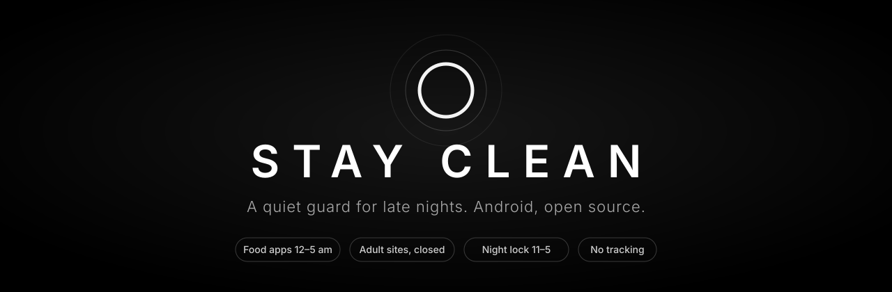
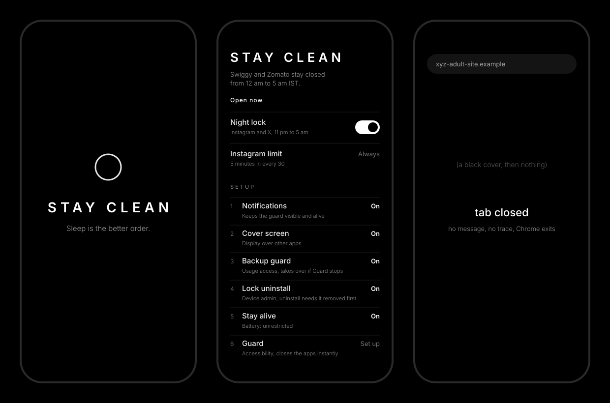
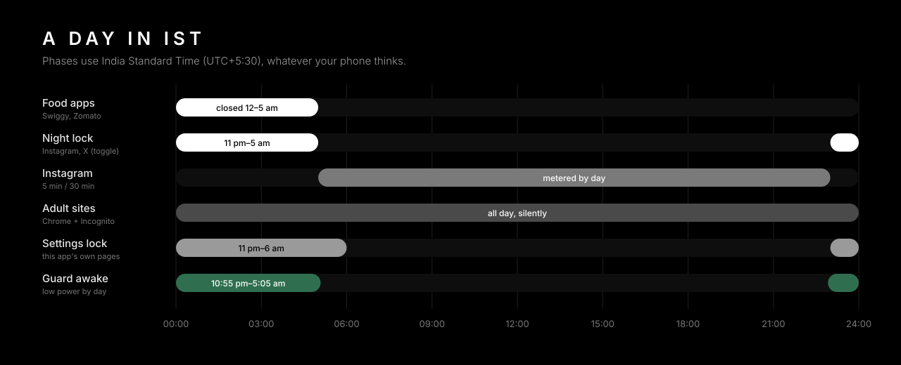

<p align="center">
  
</p>

<p align="center">
  <a href="https://github.com/abhilashongit/StayClean/releases/latest"></a>
  &nbsp;
  <a href="docs/INSTALL.md"></a>
</p>

<p align="center">
  
  
  
  
  
</p>

---

## Hello 👋

**Stay Clean** is a small, calm Android app for the hours when willpower is lowest. It shuts a few doors at night and keeps them shut, without lectures, ads or accounts.

When you open a blocked app, the screen fades to black, says **STAY CLEAN**, adds one kind line, and sends you home.

<p align="center"></p>
<p align="center"><sub>Illustrations of the three moments, drawn from the app's real wording. Your phone may look slightly different.</sub></p>

## What it does

| | Feature | How it behaves |
|---|---|---|
| 🍜 | **Food-app curfew** | Swiggy and Zomato close the moment they open, **12:00 am to 5:00 am IST**. |
| 🌙 | **Night lock** (toggle) | Instagram and X are held shut **11 pm to 5 am**. Once it is on at night, it stays on until morning. |
| ⏱️ | **Instagram limit** | **5 minutes in every 30**. Past that, you see *"Back in N min."* |
| 🚫 | **Adult-site filter** | Close the tab quietly (Incognito included), then leave Chrome. No message, no trace. |
| 🔋 | **Easy on battery** | Sleeps through the day, wakes before the night window. |
| 🔒 | **Hard to undo on a whim** | Uninstall needs Device Admin removed first. This app's settings pages stay shut from 11 pm to 6 am. |

Every line under STAY CLEAN is drawn from a shuffled bag of 39 short, kind phrases, so you do not see the same one twice in a row.

## A day in IST

<p align="center"></p>

Times are fixed to **India Standard Time (UTC+5:30)**. Stay Clean also checks a network-time anchor, and when the phone clock and trusted time disagree, the stricter answer wins. Changing the system clock does not buy you a loophole.

## Install on Android (2 minutes)

1. On your phone, open the **[latest release](https://github.com/abhilashongit/StayClean/releases/latest)** and download **`stay-clean-v1.4.apk`**.
2. Open the file. If Android asks, allow your browser to *install unknown apps*.
3. If **Play Protect** warns you, tap **More details → Install anyway**. This is normal for apps outside the Play Store that use Accessibility ([why](docs/INSTALL.md#why-play-protect-warns)).
4. Open **Stay Clean** and finish the six **SETUP** rows, top to bottom. Do **Guard** last.
5. If Guard is greyed out: **Settings → Apps → Stay Clean → ⋮ → Allow restricted settings**, then try again.

Full walk-through with screenshots-in-words and fixes: **[docs/INSTALL.md](docs/INSTALL.md)**.

Want to verify the file first? Compare its checksum with `dist/SHA256SUMS.txt`:

```bash
sha256sum -c dist/SHA256SUMS.txt
```

## Your privacy

- **No analytics, no ads, no accounts, no cloud.** Everything stays on the phone.
- The only network call is a tiny `HEAD` request to Google or Cloudflare to read the `Date` header, so the app can tell real time from a tampered clock.
- The Accessibility service reads only the foreground app name and the browser address bar, to decide whether to close something. Nothing is stored or sent.

Details: **[docs/PRIVACY.md](docs/PRIVACY.md)**.

## Honest limits

Stay Clean is a speed bump built for a moment of weakness, not a prison. A determined you can still win: Safe Mode, `adb uninstall`, a factory reset, or switching the guard off by day. Browser layouts also change, so the tab closer has fallbacks, and the adult filter is a host-name heuristic that can miss a site or, rarely, catch an innocent one. More in **[docs/HOW_IT_WORKS.md](docs/HOW_IT_WORKS.md#known-limits)**.

If something feels stuck, see **[docs/TROUBLESHOOTING.md](docs/TROUBLESHOOTING.md)**.

## Build it yourself

```bash
git clone https://github.com/abhilashongit/StayClean.git
cd StayClean
./gradlew test assembleDebug        # needs JDK 17+ and the Android SDK
```

Debug APK: `app/build/outputs/apk/debug/app-debug.apk`. Signed release builds are explained in **[docs/BUILDING.md](docs/BUILDING.md)**.

## Repository map

```
StayClean/
├── app/                      Android app (Java, no AndroidX)
│   └── src/
│       ├── main/java/com/stayclean/   guard logic, overlay, services
│       ├── main/res/                  Inter font, icon, accessibility config
│       └── test/java/com/stayclean/   48 JVM tests
├── assets/                   banner, icon, screens, timeline (+ SVG sources)
├── docs/                     INSTALL, HOW_IT_WORKS, PRIVACY, BUILDING, TROUBLESHOOTING
├── dist/                     release checksum
├── licenses/                 Inter font licence (SIL OFL 1.1)
└── .github/                  CI and issue templates
```

## Contributing

Kind pull requests are welcome, especially new phrases, translations of the docs, and notes on how other browsers behave. See **[CONTRIBUTING.md](CONTRIBUTING.md)**.

## Credits and licence

Code is released under the **[MIT License](LICENSE)**. The typeface is **Inter** by Rasmus Andersson, under the [SIL Open Font License 1.1](licenses/Inter-OFL.txt).

Stay Clean is an independent project. It is **not affiliated with or endorsed by** Swiggy, Zomato, Instagram, X, Google or Meta. All names belong to their owners.

<p align="center"><sub>Built for the quiet hours. Be kind to yourself. 🤍</sub></p>
